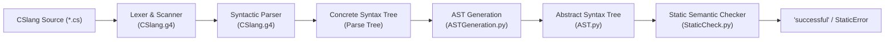
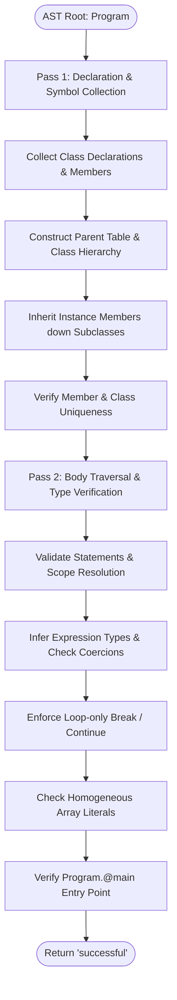

# CSlang Compiler Front-End: Grammar, AST Generation & Static Type Checker

[](https://www.python.org/)
[](https://www.antlr.org/)
[](https://www.cse.hcmut.edu.vn/)
[](https://hcmut.edu.vn/)

A complete compiler front-end implementation for **CSlang**, an educational object-oriented programming language designed for the **Principles of Programming Languages (CO3005)** course at Ho Chi Minh City University of Technology (HCMUT / VNU-HCM).

This repository contains the end-to-end front-end pipeline:
1. **Lexical & Syntactic Specification**: Formal language grammar in ANTLR4 (`CSlang.g4`).
2. **AST Generation**: Parse tree transformation into an Abstract Syntax Tree (`ASTGeneration.py`).
3. **Static Type Checking & Semantic Analysis**: Two-pass semantic analyzer and type checker (`StaticCheck.py`).
4. **Comprehensive Test Suites**: Unit tests for lexing, parsing, AST generation, and semantic analysis.

---

## Table of Contents

- [Compiler Front-End Pipeline](#compiler-front-end-pipeline)
- [1. Lexical & Syntactic Analysis (ANTLR4 Grammar)](#1-lexical--syntactic-analysis-antlr4-grammar)
- [2. AST Generation](#2-ast-generation)
- [3. Static Type Checking & Semantic Analysis](#3-static-type-checking--semantic-analysis)
- [CSlang Language Highlights](#cslang-language-highlights)
- [Project Structure](#project-structure)
- [Quickstart & Testing](#quickstart--testing)
- [Course Specifications](#course-specifications)
- [License & Course Context](#license--course-context)

---

## Compiler Front-End Pipeline



---

## 1. Lexical & Syntactic Analysis (ANTLR4 Grammar)

Defined in [`src/main/CSlang/parser/CSlang.g4`](file:///home/toan/projects/ppl-ass3-2023/src/main/CSlang/parser/CSlang.g4):

### Lexical Structure
- **Keywords**: `class`, `func`, `constructor`, `var`, `const`, `if`, `else`, `for`, `break`, `continue`, `return`, `self`, `new`, `null`, `int`, `float`, `bool`, `string`, `void`.
- **Identifiers**:
  - Regular identifiers: `[a-zA-Z_][a-zA-Z0-9_]*` for instance attributes, methods, local variables, and class names.
  - `@`-prefixed identifiers (`STATIC_ID`): `[@][a-zA-Z0-9_]+` for static class attributes and static methods (e.g. `@main`, `@count`).
- **Literals**:
  - Decimal integers (`INTLIT`).
  - Floating-point numbers (`FLOATLIT`) with decimal points and optional scientific exponent (`12e8`, `0.33E-3`, `1.`).
  - Booleans (`true`, `false`).
  - Strings (`STRINGLIT`) with escape sequences (`\b`, `\f`, `\r`, `\n`, `\t`, `\"`, `\\`).
  - Array literals (`[1, 2, 3]`).
- **Lexical Error Handling**: Embedded lexer actions detect and throw custom exceptions:
  - `ErrorToken`: Unrecognized character encountered.
  - `UncloseString`: String literal not closed before newline or EOF.
  - `IllegalEscape`: Invalid escape sequence within string literal.

### Syntactic Grammar & Operator Precedence
The grammar enforces standard programming language operator precedence from highest to lowest:
1. **Postfix**: Member access (`obj.field`), static access (`Class.@field`), method invocation (`obj.method()`), indexing (`arr[idx]`).
2. **Object Creation**: `new ClassName(args)` (right-associative).
3. **Unary**: Sign (`+`, `-`), logical NOT (`!`) (right-associative).
4. **Multiplicative**: `*`, `/`, `\`, `%` (left-associative).
5. **Additive**: `+`, `-` (left-associative).
6. **Logical**: `&&`, `||` (left-associative).
7. **Relational**: `==`, `!=`, `<`, `<=`, `>`, `>=` (non-associative).
8. **String Concatenation**: `^` (non-associative).
9. **Statements**: Variable/Constant declarations, assignments (`:=`), conditional statements with optional pre-statements (`if [{ pre; }]? cond { then; } else { else; }`), `for` loops, `break`, `continue`, and `return`.

---

## 2. AST Generation

Implemented in [`src/main/CSlang/astgen/ASTGeneration.py`](file:///home/toan/projects/ppl-ass3-2023/src/main/CSlang/astgen/ASTGeneration.py):

Transforms the ANTLR parse tree into an Abstract Syntax Tree composed of clean node classes defined in `AST.py`:
- **Visitor Pattern**: Subclasses `CSlangVisitor` generated by ANTLR to map CST contexts to AST classes.
- **Flattening Declarations**: Multi-variable declarations (e.g. `var a, b: int = 1, 2;`) are expanded into individual `VarDecl` / `ConstDecl` nodes.
- **Parameter Handling**: Handles parameter lists sharing common types (e.g. `a, b: int`).
- **Inheritance & Constructors**: Resolves class inheritance representations (`ClassDecl(name, members, parent)`) and constructor methods (`MethodDecl(Id('constructor'), ...)`).
- **Control Flow**: Encapsulates `If`, `For`, `Break`, `Continue`, `Return`, and block statements.

---

## 3. Static Type Checking & Semantic Analysis

Implemented in [`src/main/CSlang/checker/StaticCheck.py`](file:///home/toan/projects/ppl-ass3-2023/src/main/CSlang/checker/StaticCheck.py):

A two-pass AST visitor that enforces CSlang semantic rules and raises exceptions defined in `StaticError.py`:



### Supported Semantic Checks & Error Taxonomy

| # | Error Exception | Rule Description | Example Trigger |
|---|---|---|---|
| 1 | `Redeclared(Kind, name)` | Duplicate identifier in the same scope (`Class`, `Attribute`, `Method`, `Parameter`, `Variable`, `Constant`). | `class A {} class A {}` |
| 2 | `Undeclared(Kind, name)` | Use of an identifier not declared in current or inherited scopes (`Class`, `Attribute`, `Method`, `Identifier`). | `x := 10;` without `var x: int;` |
| 3 | `CannotAssignToConstant(stmt)` | Attempting to mutate an immutable identifier (`const` attribute or local constant) in assignment or for-loop. | `const c: int = 1; c := 2;` |
| 4 | `TypeMismatchInStatement(stmt)` | Statement violates type rules: `if`/`for` condition not `bool`, invalid assignment types, void method called in expression, or return type mismatch. | `if 10 { ... }` |
| 5 | `TypeMismatchInExpression(expr)` | Expression violates type rules: non-integer array index, mismatched operands, calling non-existent constructor, or invalid member access. | `arr["key"]` or `1 + "text"` |
| 6 | `TypeMismatchInDeclaration(decl)` | Initializer type cannot coerce to declared type, `const` declared without initializer, or variable of type `void`. | `var x: void;` or `const PI: float;` |
| 7 | `MustInLoop(stmt)` | `break` or `continue` executed outside of an active `for` loop body. | `func foo(): void { break; }` |
| 8 | `IllegalArrayLiteral(literal)` | Array literal containing elements of differing types. | `[1, 2.5, "three"]` |
| 9 | `NoEntryPoint()` | Missing class `Program` with a static parameterless void method `func @main(): void`. | Missing `@main` method |

---

## CSlang Language Highlights

### Example Program
```cslang
class Shape {
    var @count: int = 0;       // Static attribute
    var name: string;          // Instance attribute

    func constructor(n: string) {
        self.name := n;
        Shape.@count := Shape.@count + 1;
    }

    func describe(): void {
        io.@writeStr(self.name);
    }
}

class Circle <- Shape {        // Single inheritance
    var radius: float;

    func constructor(n: string, r: float) {
        self.name := n;
        self.radius := r;
    }

    func getArea(): float {
        return 3.14159 * self.radius * self.radius;
    }
}

class Program {
    func @main(): void {       // Required static entry point
        var c: Circle = new Circle("MyCircle", 2.5);
        c.describe();
        io.@writeFloat(c.getArea());
    }
}
```

### Key Language Features
- **Object-Oriented**: Classes, single inheritance (`class Sub <- Super`), encapsulation, and polymorphism.
- **Static vs Instance Members**: Identifiers prefixed with `@` represent static members; bare identifiers represent instance members.
- **Entry Point**: A static parameterless method `func @main(): void` located inside `class Program`.
- **Type Coercion**: `int` automatically coerces to `float`; derived classes automatically coerce to base classes.
- **Built-in IO**: Standard `io` class with `@readInt`, `@writeInt`, `@readFloat`, `@writeFloat`, `@readBool`, `@writeBool`, `@readStr`, `@writeStr`.

---

## Project Structure

```
ppl-ass3-2023/
├── README.md                          # Main project documentation
├── requirements.txt                   # Python package dependencies
├── .gitignore                         # Git ignore rules
└── src/
    ├── run.py                         # CLI test runner and build harness
    ├── .coveragerc                    # Code coverage configuration
    │
    ├── main/
    │   └── CSlang/
    │       ├── parser/
    │       │   ├── CSlang.g4          # Complete CSlang Lexer & Parser Grammar
    │       │   └── lexererr.py        # Custom lexer exception classes
    │       ├── astgen/
    │       │   └── ASTGeneration.py   # Parse Tree -> AST Transformer
    │       ├── checker/
    │       │   ├── StaticCheck.py     # Static Semantic Checker (Pass 1 & 2)
    │       │   └── StaticError.py     # Semantic error exception hierarchy
    │       └── utils/
    │           ├── AST.py             # Abstract Syntax Tree node definitions
    │           ├── Visitor.py         # Base Visitor class
    │           └── Utils.py           # Helper data structures (MType, Symbol)
    │
    ├── gen/                           # Pre-generated ANTLR4 Python recognizers
    │   ├── CSlangLexer.py
    │   ├── CSlangParser.py
    │   ├── CSlangVisitor.py
    │   └── CSlangListener.py
    │
    ├── test_folder/
    │   ├── LexerSuite.py              # Lexical scanner test suite
    │   ├── ParserSuite.py             # Syntactic parser test suite
    │   ├── ASTGenSuite.py             # AST generation test suite
    │   ├── CheckSuite.py              # 101 semantic checker test cases
    │   └── TestUtils.py               # Test runner harness & test drivers
    │
    └── spec/
        ├── Assignment Spec 1.0.3.pdf  # CSlang Language Specification v1.0.3
        ├── _231_CO3005__Assignment (3).pdf # Assignment 3 Spec v1.1
        └── Assignment 3  Spec.pdf     # Assignment 3 Spec v1.0
```

---

## Project Structure

```
ppl-ass3-2023/
├── README.md                          # Main project documentation
├── requirements.txt                   # Python package dependencies
├── .gitignore                         # Git ignore rules
└── src/
    ├── run.py                         # CLI test runner and build harness
    ├── .coveragerc                    # Code coverage configuration
    │
    ├── main/
    │   └── CSlang/
    │       ├── parser/
    │       │   ├── CSlang.g4          # Complete CSlang Lexer & Parser Grammar
    │       │   └── lexererr.py        # Custom lexer exception classes
    │       ├── astgen/
    │       │   └── ASTGeneration.py   # Parse Tree -> AST Transformer
    │       ├── checker/
    │       │   ├── StaticCheck.py     # Static Semantic Checker (Pass 1 & 2)
    │       │   └── StaticError.py     # Semantic error exception hierarchy
    │       └── utils/
    │           ├── AST.py             # Abstract Syntax Tree node definitions
    │           ├── Visitor.py         # Base Visitor class
    │           └── Utils.py           # Helper data structures (MType, Symbol)
    │
    ├── gen/                           # Pre-generated ANTLR4 Python recognizers
    │   ├── CSlangLexer.py
    │   ├── CSlangParser.py
    │   ├── CSlangVisitor.py
    │   └── CSlangListener.py
    │
    ├── test_folder/
    │   ├── LexerSuite.py              # Lexical scanner test suite
    │   ├── ParserSuite.py             # Syntactic parser test suite
    │   ├── ASTGenSuite.py             # AST generation test suite
    │   ├── CheckSuite.py              # 101 semantic checker test cases
    │   └── TestUtils.py               # Test runner harness & test drivers
    │
    └── spec/
        ├── Assignment Spec 1.0.3.pdf  # CSlang Language Specification v1.0.3
        ├── _231_CO3005__Assignment (3).pdf # Assignment 3 Spec v1.1
        └── Assignment 3  Spec.pdf     # Assignment 3 Spec v1.0
```

---

## Quickstart & Testing

### 1. Prerequisites
- **Python**: 3.8 or newer.
- **Java**: 11+ (only needed if re-generating ANTLR recognizers from `CSlang.g4`; pre-generated files are already included in `src/gen/`).

### 2. Environment Setup

```bash
# 1. Clone repository
git clone https://github.com/your-username/ppl-ass3-2023.git
cd ppl-ass3-2023

# 2. Create and activate virtual environment
python3 -m venv .venv
source .venv/bin/activate  # On Windows: .venv\Scripts\activate

# 3. Install dependencies
pip install -r requirements.txt
```

### 3. Running Unit Tests

Navigate to `src/` to execute any of the test suites:

```bash
cd src

# Run Semantic Checker test suite (100+ tests)
python3 run.py test CheckSuite

# Run AST Generation test suite
python3 run.py test ASTGenSuite

# Run Syntactic Parser test suite
python3 run.py test ParserSuite

# Run Lexical Scanner test suite
python3 run.py test LexerSuite
```

### 4. Running Code Coverage

```bash
cd src
coverage run --rcfile=.coveragerc run.py test CheckSuite
coverage report -m
```

### 5. Rebuilding Grammar with ANTLR4 (Optional)

If modifying `src/main/CSlang/parser/CSlang.g4`:

```bash
cd src
export ANTLR_JAR=/path/to/antlr-4.13.1-complete.jar
python3 run.py gen
```

---

## Course Specifications

Official course PDFs are located in [`src/spec/`](file:///home/toan/projects/ppl-ass3-2023/src/spec/):
- [CSlang Language Specification (v1.0.3)](file:///home/toan/projects/ppl-ass3-2023/src/spec/Assignment%20Spec%201.0.3.pdf)
- [Assignment 3 Static Checker Specification (v1.1)](file:///home/toan/projects/ppl-ass3-2023/src/spec/_231_CO3005__Assignment%20(3).pdf)

---

## License & Course Context

This project was developed for the **Principles of Programming Languages (CO3005)** course at the Faculty of Computer Science and Engineering, **Ho Chi Minh City University of Technology (HCMUT - VNU-HCM)**.

Official course PDFs are located in [`src/spec/`](file:///home/toan/projects/ppl-ass3-2023/src/spec/):
- [CSlang Language Specification (v1.0.3)](file:///home/toan/projects/ppl-ass3-2023/src/spec/Assignment%20Spec%201.0.3.pdf)
- [Assignment 3 Static Checker Specification (v1.1)](file:///home/toan/projects/ppl-ass3-2023/src/spec/_231_CO3005__Assignment%20(3).pdf)

---

## License & Course Context

This project was developed for the **Principles of Programming Languages (CO3005)** course at the Faculty of Computer Science and Engineering, **Ho Chi Minh City University of Technology (HCMUT - VNU-HCM)**.
